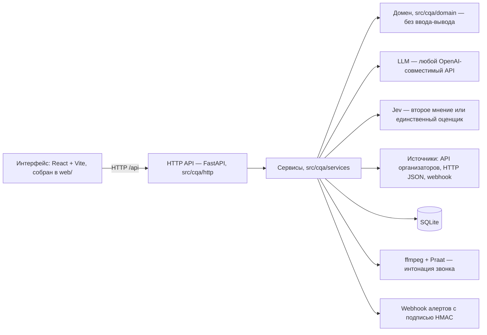

# CQA — контроль качества диалогов

Сервис оценивает чаты и звонки контакт-центра по чек-листу. Языковая модель отвечает на каждый критерий с обоснованием и репликой-основанием. Итог считает код по формуле чек-листа. Спорные ответы уходят человеку, оператор может оспорить оценку критерия и грубую ошибку. Для звонков интонационные признаки (тон, громкость, темп, паузы, перебивания) считаются локально из записи. Интерфейс — React-приложение на русском, английском и казахском, собранное в `web/`. Сервер — FastAPI и SQLite в одном процессе.

## Преимущества
### Безопасность
* Поддерживает настройку, которая позволяет использовать как внешние API (LLM, модель извлечения признаков, например Jev AI / TypeSafe), так и полностью развернуть решение внутри контура.
* В случае запросов за пределы территории Казахстана или к внешним AI-провайдерам есть возможность предварительно обезличивать данные. Обезличивание включено по умолчанию.
### Стоимость
* Можно подключить очень дешёвую модель Jev AI (TypeSafe). Примерная стоимость $0.04 за 1M входных токенов, выход бесплатный. Это в разы дешевле и быстрее обычных LLM; разница зависит от выбранной модели.
* При развёртывании на собственной инфраструктуре можно сократить расходы практически до нуля.
* Чтобы избежать вендорной привязки, весь SQL собран в одном адаптере: другая СУБД — новый адаптер, остальной код не меняется. Сейчас это один процесс и SQLite; горизонтальное масштабирование — следующий шаг.
### Надёжность
* Можно включить второе мнение: вторая модель (Jev или другая LLM) параллельно отвечает на те же критерии. Если ответы расходятся или цитата-основание не прошла проверку, пункт уходит на проверку человеку. По умолчанию второе мнение выключено.
* Проверено на русском, казахском и английском: один чек-лист и один промпт на три языка. На эталоне из 24 чатов DEV согласие с разметкой команды — RU 0,94, KZ 0,95, EN 1,00.

## Посмотреть без ключа

```bash
uv sync
make demo        # набор защиты: 8 диалогов, сценарий защиты
make showcase    # витрина: 48 диалогов за 5 дней, экраны аналитики
```

Обе команды работают на записанных ответах модели (`CQA_LLM_MODE=replay`). Ключ модели и адрес API организаторов не нужны.

`make demo` поднимает сервер на `http://127.0.0.1:8000` с базой `data/demo.db`. Он загружает синтетический набор `tests/e2e/fixtures/defence_set.json` (8 диалогов, включая звонок) и вымышленных сотрудников, оценивает набор и заводит два демо-источника на странице «Источники данных». Откройте очередь, карточку, апелляции, чек-лист и аналитику. Если записанных ответов нет, команда останавливается с подсказкой: их пишет `make record` с ключом модели и только на синтетических данных.

`make showcase` каждый раз создаёт свежую базу `data/showcase.db`. В неё идут набор защиты и витрина `tests/fixtures/showcase_set.json`: 40 вымышленных диалогов брокерского контакт-центра за 2–6 ноября. Языки: RU 24, KZ 8, EN 8. Каналы: 32 чата и 8 звонков без записи. Всё оценивается, затем проверяются правила алертов. Другой порт — `PORT=8020 make showcase`. У каждого из 5 операторов по 8 диалогов и свой профиль:

| Оператор | Профиль |
| --- | --- |
| Айгерим Т. | сильный: полная консультация, срок, итог, корректная эскалация |
| Руслан М. | слабая консультация: общие или ошибочные ответы, нет следующего шага, одна платная услуга в обход компании |
| Камила Ж. | торопит завершение: ответ верный, но без уточнений, срока и прощания |
| Нурлан Б. | риск безопасности: пропускает идентификацию, раскрывает данные, в том числе третьему лицу, одно оскорбление |
| Елена В. | звонки и ожидание: долгие удержания без предупреждения, сбивчивые объяснения, плохо отвечает на «позовите руководителя» и жалобу регулятору |

В `make demo` у каждого сотрудника n = 2, а сравнивать сотрудников можно от n = 5. Поэтому экраны «Сотрудники», «Алерты» и рекомендации показываем на `make showcase`. Записи ответов модели для витрины проверяет `tests/integration/test_showcase_set.py`.

Документация продукта открывается на том же сервере: `http://127.0.0.1:8000/docs/`, справочник API — `/docs/api`. Ниже ссылки вида [/docs/operator](docs/site/04-operator.md) ведут на исходник страницы в репозитории.

## Возможности

**Оператор**
- Карточка разговора: итог, «Как посчитан итог», главные потери с обоснованием и переходом к реплике или моменту записи — [/docs/operator](docs/site/04-operator.md).
- Апелляция на оценку критерия и на грубую ошибку; исходная оценка остаётся в истории — [/docs/operator](docs/site/04-operator.md).
- «Обучение»: где теряются баллы, «Как сказать лучше» и лист разбора для встречи — [/docs/operator](docs/site/04-operator.md).

**Специалист КК**
- Очередь «Диалоги»: группы «Грубые ошибки» и «Нужна проверка», фильтры, массовая перепроверка — [/docs/qa-specialist](docs/site/03-qa-specialist.md).
- Загрузка: набор организаторов по `group_id`, файл JSON, вставка текста — [/docs/qa-specialist](docs/site/03-qa-specialist.md).
- Оценка набора или одного диалога, ручной ответ по критерию — [/docs/qa-specialist](docs/site/03-qa-specialist.md).
- Чек-лист как данные: критерии, веса, N/A, уточнения для звонка, версии и «Что изменится» — [/docs/checklist](docs/site/07-checklist.md).
- Экспорт версии чек-листа: JSON, CSV, Markdown, памятка A4; импорт JSON и вопросов Jev — [/docs/checklist](docs/site/07-checklist.md).
- Настройка чек-листа по API: шкала оценок, «что если», нормировка весов, шаблоны, готовые чек-листы, песочница — [/docs/api](docs/site/11-api.md).
- Перепроверка той же или другой моделью: «Только сравнить» или «Заменить», сравнение и история оценок — [/docs/api](docs/site/11-api.md).
- Правила недостаточности данных: `block`, `flag`, `info`; модель не додумывает пустой диалог — [docs/insufficient-data.md](docs/insufficient-data.md).

**Проверяющий**
- «Апелляции»: подтвердить или изменить оценку, причина обязательна, итог пересчитывается — [/docs/reviewer](docs/site/05-reviewer.md).
- «Нужна проверка»: расхождения второго мнения, непрошедшие цитаты, неуверенный Jev, «Мало данных» — [/docs/reviewer](docs/site/05-reviewer.md).
- Коды причин решений и доля ответов, изменённых людьми, по API: `/api/appeals/reasons`, `/api/appeals/stats` — [/docs/api](docs/site/11-api.md).
- Интонационные признаки звонка: панель «Интонация» и значки у реплик — [/docs/intonation](docs/site/08-intonation.md).

**Руководитель**
- «Аналитика»: потери по критериям, языкам и темам, грубые ошибки по видам, где модель расходится с людьми — [/docs/manager](docs/site/06-manager.md).
- Расширенная аналитика: тренд, тепловая карта, драйверы, распределения, срезы, апелляции, сигналы модели; у каждой ячейки n — [/docs/api](docs/site/11-api.md).
- «Сотрудники»: средний итог с n и 95 % интервалом; при n < 5 — «недостаточно данных» вместо сравнения — [/docs/manager](docs/site/06-manager.md).
- Рекомендации оператору, проверяющему, руководителю и по чек-листу: явные правила без модели, у каждой — числа и диалоги — [/docs/manager](docs/site/06-manager.md).
- Статистика разговора в карточке: доля речи, монологи, паузы, перебивания, время ответа в чате рядом с нормой команды — [/docs/api](docs/site/11-api.md).
- Алерты и маркеры с «Почему»: правило, порог, наблюдённое значение, реплики; принять, назначить, решить — [/docs/api](docs/site/11-api.md).
- Темы обращений и маркеры риска брокера: справочник — данные, тему выбирает модель или Jev с обоснованием — [/docs/api](docs/site/11-api.md).
- «Отчёты»: отчёт для руководства (HTML A4, Markdown, JSON), оценки в Excel (CSV), замеры качества и прогоны в json, csv, md, html — [/docs/manager](docs/site/06-manager.md).

**Данные и обработка**
- «Источники данных»: API организаторов, HTTP JSON, webhook, файл, вставка; здоровье и журнал синхронизаций — [/docs/integration](docs/site/10-integration.md).
- «Пакеты»: очередь с приоритетом, пауза, продолжение, отмена, повтор, оценка времени до конца — [/docs/api](docs/site/11-api.md).
- «Правила обработки»: своя модель, второе мнение и обезличивание по каналу, языку, источнику, теме и длине диалога — [/docs/api](docs/site/11-api.md).
- «Автоматизация»: автосинхронизация и автооценка с лимитом в час, дневным бюджетом и тихими часами; по умолчанию выключена — [/docs/api](docs/site/11-api.md).
- Режим оценки из интерфейса: провайдеры, «Только Jev», второе мнение, обезличивание, реальные звонки — [/docs/qa-specialist](docs/site/03-qa-specialist.md).

**Для всех**
- Интерфейс RU, EN, KZ; светлая, тёмная и системная тема; телефон с нижней панелью вкладок.
- «Вы вошли как»: сотрудник из справочника, журнал действий и обзор работы команды — [/docs/api](docs/site/11-api.md).
- Метрики использования без текста диалогов — [docs/telemetry.md](docs/telemetry.md).
- Документация `/docs/` и справочник API от того же сервера, без интернета — [/docs/overview](docs/site/01-overview.md).

## Архитектура



Один процесс. В нём же три фоновые задачи: синхронизация источников, очередь пакетов и автоматизация. Сервисы держат сценарии использования. Домен — расчёт итога, промпты, разбор ответов, аналитика и правила, без ввода-вывода. Внешний мир — за адаптерами в `src/cqa/adapters`. Другой провайдер или СУБД — новый адаптер, остальной код не меняется.

Интерфейс: исходники в `frontend/` (React 18, TypeScript, Vite, Tailwind), `make web` собирает их в `web/`. Собранный `web/` лежит в git, поэтому `make run` и `make demo` работают без Node. Чистая логика (итог, очередь, аналитика, клиент API) — ES-модули `frontend/src/lib/*.js`, их проверяет `node --test`. Прежний интерфейс без сборки открывается по адресу `/legacy/`. Разработка с живым сервером: `make run`, затем `npm --prefix frontend run dev`.

## Запуск

```bash
uv sync
cp .env.example .env   # заполните нужные CQA_*: ключ модели, адрес API организаторов
make run               # http://127.0.0.1:8000
```

Пустые значения в `.env` берут умолчания из `src/cqa/settings.py`. Профили «сценарий 4» (Qwen у провайдера в Казахстане), «сценарий 5» (запасной) и «сценарий 6» (локальная модель) лежат комментариями в `.env.example`. Реальные звонки уходят в модель только при `CQA_ALLOW_REAL_DATA=1`, его ставит человек.

Интонация звонков требует системный `ffmpeg` в `PATH`. Praat приезжает с `uv sync` (пакет `praat-parselmouth`). Без ffmpeg панель «Интонация» недоступна, остальное работает.

Загрузка диалогов:

- По `group_id`: «Добавить диалоги» → «Набор организаторов…», код `DEV`, «Получить набор». Сервер сам ходит в API организаторов (`CQA_ORG_API_URL`), браузер адреса не видит. Через API: `curl -X POST http://127.0.0.1:8000/api/datasets -H 'Content-Type: application/json' -d '{"group_id": "DEV"}'`.
- Со ссылкой API в том же окне: сервер хранит ссылку у себя и забирает набор раз в 5 минут. Оценка сама не запускается, если не включена автоматизация.
- Файлом JSON в формате ответа API организаторов (`POST /api/datasets/upload`) или вставкой текста «Клиент: …» / «Оператор: …» (`POST /api/dialogs/text`).
- Другие источники — страница «Источники данных»: HTTP JSON с сопоставлением полей, webhook с токеном, проверка связи и журнал синхронизаций.
- «Оценить» запускает оценку видимых диалогов. «Остановить» прерывает, повторный запуск продолжает с места остановки: готовые ответы не пересчитываются.

## Запуск в Docker

```bash
make docker-build   # образ cqa:latest на python:3.12-slim, зависимости из uv.lock
make docker-run     # порт 8000, том ./data для базы, CQA_* из .env (если есть)
```

`docker-compose.yml` подхватывает `.env`, если он есть. Без него контейнер стартует в `replay` на записанных ответах: ключ модели и адрес API организаторов не нужны. Секреты и локальная база в образ не попадают (`.dockerignore`).

## Доступ для жюри по сети

`make share` запускает сервер на `0.0.0.0:8000` (порт — `PORT=…`) и печатает ссылку для входа вида `http://<IP ноутбука>:8000/login?token=<токен>`. Токен берётся из `CQA_ACCESS_TOKEN`, а если он пуст — создаётся новый на этот запуск. Ссылка ставит в браузере cookie `cqa_access` (HttpOnly, SameSite=Lax) и открывает интерфейс. Без cookie интерфейс показывает только «Доступ по ссылке с токеном», `/api/*` отвечает 401; открыт лишь `/api/health`. Так никто в Wi-Fi площадки без ссылки не поменяет чек-лист, ключи моделей и режим данных. Токен не пишется в журнал сервера.

Отозвать доступ: остановите сервер (Ctrl+C) и запустите без токена (`make run`, только `127.0.0.1`) или снова `make share` — новый токен, старые cookie перестают подходить. Пустой `CQA_ACCESS_TOKEN` в `make run` и `make demo` оставляет вход открытым.

## Сдача результатов

Файл для организаторов в формате JSON 1.0 собирает `make results`: `make results SET=dev` — по снимку DEV, `make results SET=prod GROUP=<group_id>` — по контрольному набору. Набор, загруженный файлом, передаётся как `ARGS="--source <файл>"`. С `ARGS=--evaluate` набор загружается, оценивается и выгружается одной командой: `make results SET=prod GROUP=<group_id> ARGS=--evaluate`. Файл пишется в `results/<set>/results.json` и проверяется: нет повторов id, у оценённых все критерии на месте, в `prod` ровно 10 записей. Текущий `results/dev/results.json` — 65 диалогов, все со статусом `ok`. Регламент — `docs/runbook.md` и [/docs/control-hour](docs/site/14-control-hour.md), параметры — `scripts/results.py --help`.

## Режимы модели

- **Окно «Режим оценки»** открывается кликом по плашке в шапке. В нём: где обрабатываются данные (локально, в Казахстане, за рубежом), обезличивание, основная модель из подключённых, оценщик, второе мнение, разрешение отправлять реальные звонки. Применяется сразу, без перезапуска, хранится в базе поверх `.env`. Ключи в браузер не возвращаются.
- **Несколько провайдеров.** Любой OpenAI-совместимый API со своим адресом, моделью и ключом; заводится в окне режима или `CQA_PROVIDERS`, есть проверка связи.
- **«Только Jev»** (`CQA_EVALUATOR=jev`): все критерии диалога отвечает Jev одним запросом, ключ языковой модели не нужен. Обоснований и цитат нет, у ответа только вероятность. Вероятность ниже 0,6 или её нет — ответ уходит в «Нужна проверка» с пометкой «Jev не уверен в ответе».
- **Второе мнение** (`CQA_VERIFIER=jev` или код провайдера): по умолчанию выключено. Расхождения уходят в «Нужна проверка».
- **Jev через OpenRouter.** Встроенный провайдер `openrouter-jev`, модель `typesafe/jev-router`. Это чат-модель: отвечает с обоснованием и цитатой, годится основной моделью или вторым мнением. Нужен ключ OpenRouter (`CQA_OPENROUTER_API_KEY`). «Только Jev» — другое: типизированный API TypeSafe с вероятностями, ключ `CQA_JEV_API_KEY`.
- **Правила обработки.** Для звонков, чатов, языков, источников и тем можно задать свою модель, второе мнение, обезличивание и интонацию. Первое подходящее включённое правило; без правил — общий режим. Демонстрационные правила выключены.
- **Перепроверка.** В карточке или для выбранных в очереди: «Той же моделью», «Другой моделью…», «С другими настройками…». «Только сравнить» не меняет итог, пока новые ответы не приняты; «Заменить» сразу считает итог, прежние ответы остаются в истории.
- **Ручной ответ.** «Оценить вручную» или «Изменить ответ» у критерия. Ручной ответ заменяет ответ модели, повторная оценка его не трогает.

### Локальная модель

Любой OpenAI-совместимый сервер — Ollama, vLLM, LM Studio — подхватывается теми же переменными:

```bash
CQA_LLM_MODE=live \
CQA_LLM_BASE_URL=http://localhost:11434/v1 \
CQA_LLM_MODEL=<имя модели на сервере> \
CQA_LLM_API_KEY=local \
CQA_DATA_WHERE=local \
make run
```

Ключ серверу не нужен, но проверка конфигурации требует непустого `CQA_LLM_API_KEY` — подойдёт любая строка. `CQA_DATA_WHERE=local` показывает на плашке, что данные обрабатываются локально.

## Модель и стоимость

- Модель по умолчанию: `qwen3-6` у провайдера в Казахстане (`CQA_LLM_MODEL`). Данные обезличиваются до отправки, второе мнение выключено.
- Одна оценка чата — 10 вызовов основной модели: 7 критериев и 3 подвопроса грубой ошибки. Второе мнение добавляет 1 запрос. «Только Jev» — 1 запрос на диалог.
- Если запись звонка разобрана, модель получает в запросе короткую сводку интонации: роли и номера реплик, без текста и имён. В формулу итога интонация не входит.
- В промпте действует правило «не придумывать факты»: опираться только на диалог. Если данных не хватает, это пишется в обосновании. Цитаты-основания код сверяет дословно.
- Цена `qwen3-6` у провайдера alem на момент сдачи не опубликована, поэтому в долларах мы её не считаем. В карточке видны вызовы и время каждой оценки (`Dialog.cost`). Запасной сценарий 5 (DeepSeek V4 Pro + второе мнение Jev) стоит около 0,0145 $ за диалог по тарифам DeepSeek.
- Время: в прогоне `make eval` 24 диалога оценены за 3 мин 43 с — около 10 вызовов и 9 с на диалог.
- Качество на эталоне из 24 чатов DEV, размеченных командой (`make eval`, живая модель): согласие с разметкой 0,96 — RU 0,94, KZ 0,95, EN 1,00. Полнота грубых ошибок 1,00 при нуле ложных срабатываний. Звонков в эталоне нет.

## Безопасность и данные

- Обезличивание на сервере до любой модели: почта, IBAN, карты, ИИН, телефоны, имена. В базе остаётся исходный текст — [/docs/security](docs/site/13-security.md).
- Плашка режима всегда показывает, где обрабатываются данные и включено ли обезличивание.
- Реальные звонки не уходят модели без `CQA_ALLOW_REAL_DATA=1` или разрешения в окне режима. Включает человек.
- Запись звонка разбирается локально и наружу не уходит. Система считает только интонационные признаки звука и не делает выводов о состоянии человека.
- Ключи и токены только записываются: в ответах API и в журнале действий их нет.
- Журнал действий: кто, когда, что и над чем сделал. Записи только добавляются.
- Алерты уходят на `CQA_WEBHOOK_URL`, только если он задан; тело подписано HMAC-SHA256 (`X-CQA-Signature`).
- В git нет `.env`, `data/`, реальных звонков, адреса API организаторов и ключей; `make check` ищет секреты.

### Метрики использования

Интерфейс отправляет обезличенные события работы (`POST /api/telemetry`), сводка — `GET /api/usage` (JSON или `?format=csv`). Собираются тип события из закрытого списка, время, экран, роль, id вошедшего сотрудника и короткие служебные поля. Текст диалогов, поисковые запросы, комментарии и причины апелляций не собираются: сервер отбрасывает всё лишнее. Выключить — `CQA_TELEMETRY=off`, хранение — 30 дней (`CQA_TELEMETRY_RETENTION_DAYS`). Подробно — `docs/telemetry.md`.

## Встраивание в Dynamics 365

Интерфейс — статика без CDN с относительными путями: `web/index.html`, `web/assets/*` (скрипты, стили, шрифты), `web/favicon.svg`. Имена файлов без хешей и при пересборке не меняются. Загрузите их веб-ресурсами решения и передайте адрес API параметром `data` в адресе страницы: `index.html?data=https://<сервер>/api`. Без параметра берётся атрибут `data-api` элемента `<cqa-app>`, иначе `/api`. Маршруты живут после `#`, поэтому форма Dynamics не перезагружается при переходах. Сервер отвечает на кросс-доменные запросы только с доменов `https://*.dynamics.com` (методы GET/POST/PUT, без cookies). Подробно — [/docs/dynamics](docs/site/12-dynamics.md).

## Ограничения

- Нет паролей и учётных записей. «Вы вошли как» выбирает сотрудника из справочника (заголовок `X-CQA-User`), роль — переключатель в шапке. Для показа по сети — общий токен (`make share`).
- Один активный запуск оценки за раз; пакеты идут по очереди.
- Шкала оценок, «что если», нормировка весов, шаблоны, готовые чек-листы, песочница и коды причин решений доступны через API, экранов для них в интерфейсе пока нет.
- Отдельного метода «оценить диалог одним запросом» нет: интеграция идёт через те же методы, что у интерфейса — [/docs/integration](docs/site/10-integration.md).
- Звонков в эталоне нет, поэтому точность на звонках мы не называем. Пороги интонации эвристические.
- У чатов DEV нет дат: тренд по дням строится по времени загрузки. На витрине даты есть.

## Проверка

```bash
make check   # ruff, mypy, pytest, node --test, секреты, защищённые пути
make e2e     # Playwright: экраны и сценарий защиты на записанных ответах
```

Регламент контрольного часа и защиты — `docs/runbook.md`, слайды и сценарий показа — `docs/pitch.md`.
