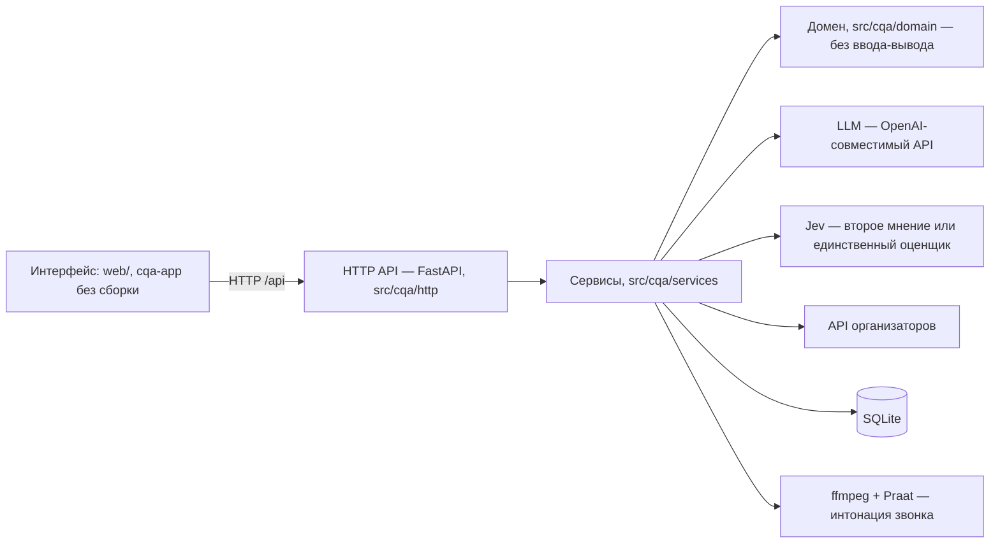

# CQA — контроль качества диалогов

Сервис оценивает чаты и звонки контакт-центра по чек-листу: языковая модель отвечает на каждый критерий с обоснованием и репликой-основанием, итог считается по формуле чек-листа, спорные ответы уходят человеку, оператор может оспорить оценку — и оценку критерия, и грубую ошибку. Для звонков интонация (тон, громкость, темп, паузы, перебивания) считается локально из записи. Интерфейс — один элемент `<cqa-app>` без сборки, сервер — FastAPI и SQLite в одном процессе.

## Преимущества
### Безопасность
* Поддерживает настройку, которая позволяет использовать как внешние API (llm, модель извлечения признаков подобные Jev Ai/TypeSafe) так и полностью развернуть внутри контура.
* В случае запросов за пределы территории Казахстана/к внешним AI провайдерам есть возможность предварительно обезличивать данные
### Стоимость
* Используется очень дешевая модель Jev Ai (TypeSafe). Примерная стоимость $0.04/$0 за 1M, что в разы дешевле обычных llm (444.6x) и в разы быстрее (193.6x) - зависит от выбранной модели
* При развертывании на собственной инфраструктуре можно сократить расходы практически до нуля
* Чтобы избежать вендорной привязки есть возможность быстро менять поставщиков БД. Заложена возможность организовать горизонтальное масштабирование в зависимости от требуемой нагрузки и для оптимизации стоимости инфраструктуры 
### Надежность
* По умолчанию при оценке параллельно анализируется двумя моделями, оценка выставляется при высокой уверенности и единогласном мнении обеих моделей. Если модели выдают сомнительный или противоположный результат, то конкретный пункт рекомендуется к проверке человеком
* Проверено на разных языках (русский/казахский/английский). Показывает высокий результат даже в случае если собеседники в процессе одной беседы несколько раз переключаются на разные языки

## Посмотреть без ключа

```bash
uv sync
make demo
```

`make demo` поднимает сервер на `http://127.0.0.1:8000` с записанными ответами модели (`CQA_LLM_MODE=replay`) и отдельной базой `data/demo.db`, загружает синтетический набор `tests/e2e/fixtures/defence_set.json` (8 диалогов прототипа, включая звонок) и оценивает его. Ключ модели и адрес API организаторов не нужны. Откройте очередь, карточку разговора с основаниями, апелляции, аналитику и обучение. Документация продукта для специалистов, руководителей и интеграторов — `http://127.0.0.1:8000/docs/`, справочник API — `/docs/api`.

Если записанных ответов нет, `make demo` останавливается с подсказкой: их пишет `make record` с ключом модели в `.env` и только на синтетических данных.

## Возможности

**Оператор**
- Карточка разговора: итог, «Как посчитан итог», главные потери с обоснованием и репликой-основанием.
- Оспаривает оценку критерия и грубую ошибку (отмечает, какие нарушения были на самом деле). Исходная оценка не меняется, решения видны в истории.

**Специалист КК**
- Редактор чек-листа: критерии, веса, N/A, общие правила и уточнения для звонков. Сохранение создаёт новую версию, «Что изменится» показывает разницу до сохранения.
- Экспорт версии: JSON, Excel (CSV), Markdown, памятка для печати A4. Импорт: JSON чек-листа и вопросы в формате Jev.
- Ручной ответ по критерию, «Оценить моделью» на один диалог, вставка диалога текстом.
- Режим оценки и модель переключаются в интерфейсе, без перезапуска; есть режим «Только Jev» — быстро и дёшево, без обоснований.

**Проверяющий**
- «Нужна проверка»: расхождения моделей, непрошедшие цитаты, неуверенные ответы Jev. Решение — с обязательной причиной.
- Грубые ошибки по видам с репликой-основанием; панель «Интонация» в карточке звонка.

**Руководство**
- Аналитика: потери по критериям и языкам, грубые ошибки по видам, повторяющиеся причины, где модель расходится с людьми.
- Вызовы, время и цена каждой оценки в карточке; файл результатов для организаторов — `make results`.

## Архитектура



Один процесс. Сервисы держат сценарии использования, домен — расчёт итога, промпты и разбор ответов, без ввода-вывода. Внешний мир — за адаптерами в `src/cqa/adapters`: LLM (любой OpenAI-совместимый сервер), Jev, API организаторов, SQLite и звук. Другой провайдер или СУБД — новый адаптер, остальной код не меняется.

## Запуск

```bash
uv sync
cp .env.example .env   # заполните нужные CQA_*: ключ модели, адрес API организаторов
make run               # http://127.0.0.1:8000
```

Интонация звонков требует системный `ffmpeg` в `PATH`: Praat приезжает с `uv sync` (пакет `praat-parselmouth`), ffmpeg ставится отдельно. Без него панель «Интонация» недоступна (сервер отвечает 502), остальное работает.

Пустые значения в `.env` берут умолчания из `src/cqa/settings.py`. Профили «сценарий 4» (Qwen у провайдера в Казахстане) и «сценарий 5» (запасной) лежат комментариями в `.env.example`. Реальные звонки уходят в модель только при `CQA_ALLOW_REAL_DATA=1`, его ставит человек.

## Запуск в Docker

```bash
make docker-build   # образ cqa:latest на python:3.12-slim, зависимости из uv.lock
make docker-run     # порт 8000, том ./data для базы, CQA_* из .env (если есть)
```

`docker-compose.yml` подхватывает `.env`, если он есть; без него контейнер стартует в `replay` на записанных ответах — ключ модели и адрес API организаторов не нужны. Секреты и локальная база в образ не попадают (`.dockerignore`). Внутри тот же сервер, что `make run`: `http://127.0.0.1:8000`.

## Доступ по сети (make share)

```bash
make share
```

Поднимает сервер на `0.0.0.0:8000` и печатает адрес этого компьютера в локальной сети (`http://<ip>:8000`) — удобно показать решение с другого устройства. Входа и авторизации нет: API и загруженные диалоги видны каждому в этой сети, запускайте только в доверенной сети (Wi-Fi команды).

## Загрузка DEV

- По `group_id`: на экране «Диалоги» введите `DEV` и нажмите «Получить набор». Сервер сам ходит в API организаторов (`CQA_ORG_API_URL`), браузер адреса не видит. То же через API: `curl -X POST http://127.0.0.1:8000/api/datasets -H 'Content-Type: application/json' -d '{"group_id": "DEV"}'`.
- Ссылкой из интерфейса: вставьте ссылку API организаторов в поле рядом с `group_id` и нажмите «Получить набор». Сервер сразу загрузит набор, сохранит ссылку у себя (в ответы она не попадает) и будет забирать этот `group_id` при старте и раз в 5 минут: новые диалоги добавятся, оценка сама не запускается. Через API: `PUT /api/source` с `{"url": "https://…", "group_id": "DEV"}`.
- Файлом: «Загрузить JSON» принимает ответ API организаторов как есть (`POST /api/datasets/upload`).
- Вставкой текста: «Вставить диалог» — название, канал и строки «Клиент: …» / «Оператор: …» (`POST /api/dialogs/text`). Оценка сама не запускается: в открывшейся карточке — «Оценить моделью».
- «Оценить» запускает оценку видимых диалогов в порядке очереди, «Остановить» прерывает, повторный запуск продолжает с места остановки: готовые ответы не пересчитываются. Прогресс виден и после перезагрузки страницы: идущий запуск запоминается в браузере.

## Режим оценки, ИИ и ручные ответы

- Режим меняется кликом по плашке режима в шапке: «Локальная модель» (любой OpenAI-совместимый сервер, например Ollama), «Внешний API, обезличенные данные» или «Внешний API без обезличивания», адрес и ключ API, второе мнение Jev с ключом, разрешение отправлять реальные звонки. Применяется сразу, без перезапуска, хранится в базе поверх `.env`; ключи в браузер не возвращаются. Открытый текст наружу и реальные звонки требуют подтверждения.
- «Только Jev» — тот же переключатель в окне режима или `CQA_EVALUATOR=jev`: все критерии диалога отвечает Jev одним запросом, быстро и дёшево; адрес и ключ языковой модели не нужны. Обоснований и реплик-оснований нет, у ответа только вероятность («Ответ Jev с вероятностью 0,93»). Вероятность ниже 0,6 или её нет — ответ уходит в «Нужна проверка» с пометкой «Jev не уверен в ответе».
- Оценка ИИ: «Оценить» на экране «Диалоги» — видимые диалоги, «Оценить моделью» в карточке — один диалог. Модель оценивает только критерии без ответа; со вторым мнением расхождения уходят на проверку.
- Ручной ответ: в карточке у критерия «Оценить вручную» (ещё не оценён) или «Изменить ответ» (роль «Специалист КК»). Ручной ответ заменяет ответ модели, повторная оценка его не трогает, итог пересчитывается сразу.
- Грубая ошибка оспаривается так же, как оценка критерия: оператор отмечает, какие нарушения были на самом деле. Флаг меняет очередь и аналитику, итог — нет.

## Чек-лист: версии, импорт и экспорт

- Редактор (`#/checklist`, роль «Специалист КК»): название, секция, текст, тип ответа, вес, N/A с условием, канал и уточнение для звонка — этот текст модель получает только на звонке, запрос по чату не меняется. Отдельно правятся общие правила чек-листа: их смена меняет смысл всех критериев.
- «Что изменится» показывает разницу черновика с текущей версией до сохранения: что добавилось, изменилось или удалено, что потребует новой оценки, а что пересчитается без модели. Разница любых версий — и после сохранения: `GET /api/checklist/diff`.
- Экспорт любой версии — меню «Экспорт» в редакторе или `GET /api/checklist/export?v=<n>&format=json|csv|md|html`: JSON, Excel (CSV), Markdown и памятка оператора для печати A4.
- Импорт: JSON чек-листа в черновик («Загрузить из файла») и вопросы в формате Jev (сливаются по ID критерия); экспорт вопросов в формат Jev — для редактора Jev.

## Интонация звонка

Панель «Интонация» в карточке звонка появляется при открытии: сводка по-русски и значки у реплик — «↑ тон», «монотонно», «быстро», «пауза N с», «перебивание». Тон, громкость, темп и паузы считаются локально: ffmpeg декодирует запись, Praat строит кадры тона и интенсивности, отклонения сравниваются с обычной манерой того же говорящего. Запись никуда не отправляется, на итог интонация не влияет.

## Модель и стоимость

- Модель: `qwen3-6` у провайдера в Казахстане (`CQA_LLM_MODEL`), данные обезличиваются до отправки, второе мнение выключено. Режим виден на плашке в шапке интерфейса.
- Одна оценка чата — 10 вызовов основной модели: 7 критериев и 3 подвопроса грубой ошибки; со вторым мнением (`CQA_VERIFIER=jev`) добавляется 1 запрос. Режим «Только Jev» — 1 запрос на диалог, без обоснований, неуверенные ответы уходят на проверку.
- В промпте действует правило «не придумывать факты»: опираться только на диалог, не приписывать участникам слов, которых нет в репликах; если данных для уверенного вывода не хватает, это пишется в обосновании.
- Цена вызовов `qwen3-6` у провайдера alem на момент сдачи не опубликована, поэтому в долларах мы её не считаем; в карточке диалога видны вызовы и время каждой оценки (`Dialog.cost`). Запасной сценарий 5 (DeepSeek V4 Pro + второе мнение Jev) стоит около 0,0145 $ за диалог по тарифам DeepSeek.
- Время: в прогоне `make eval` 24 диалога оценены за 3 мин 43 с — около 10 вызовов и 9 с на диалог.
- Качество на эталоне из 24 чатов DEV, размеченных командой (`make eval`, живая модель): согласие с разметкой 0,96 — RU 0,94, KZ 0,95, EN 1,00; полнота грубых ошибок 1,00 при нуле ложных срабатываний. Цитаты-основания код сверяет дословно.

## Локальная модель

Любой OpenAI-совместимый сервер — Ollama, vLLM, LM Studio — подхватывается теми же переменными (полный профиль «Сценарий 6» — в комментариях `.env.example`):

```bash
CQA_LLM_MODE=live \
CQA_LLM_BASE_URL=http://localhost:11434/v1 \
CQA_LLM_MODEL=<имя модели на сервере> \
CQA_LLM_API_KEY=local \
CQA_DATA_WHERE=local \
make run
```

Ключ серверу не нужен, но проверка конфигурации требует непустого `CQA_LLM_API_KEY` — подойдёт любая строка. `CQA_DATA_WHERE=local` показывает на плашке, что данные обрабатываются локально; обезличивание остаётся включённым, реплики не покидают машину.

## Jev через OpenRouter

В окне режима всегда есть провайдер «OpenRouter — Jev Router» (`openrouter-jev`): модель `typesafe/jev-router` у OpenRouter. Это чат-модель OpenAI-формата — Jev Router сам выбирает модель и глубину рассуждения под запрос, — поэтому она отвечает как любая языковая модель: с обоснованием, цитатой и репликами. Её можно выбрать основной моделью или вторым мнением. Нужен ключ OpenRouter: в окне режима или `CQA_OPENROUTER_API_KEY` в `.env`; данные уходят во внешний API (на плашке — «внешний»), обезличивание и запрет реальных звонков работают как обычно. Цену запроса сообщает OpenRouter, она идёт в `cost` вместо цены за токены. Изменить можно модель и ключ; «Удалить» возвращает провайдера к умолчанию.

«Только Jev» — другое: типизированный API TypeSafe (System One) с вероятностями ответов, нужен ключ TypeSafe (`CQA_JEV_API_KEY`), обоснований и цитат нет. Через OpenRouter этот API недоступен.

## Встраивание в Dynamics 365

Интерфейс — статика без CDN с относительными путями: `web/index.html`, `web/assets/index.js`, `web/assets/index.css`, `web/assets/Analytics.js`, `web/favicon.svg` (имена без хешей, при пересборке не меняются). Загрузите их веб-ресурсами решения и передайте адрес API параметром `data` в адресе страницы: `index.html?data=https://<сервер>/api`. Без параметра берётся атрибут `data-api` элемента `<cqa-app>`, иначе `/api`. Маршруты живут после `#`, поэтому форма Dynamics не перезагружается при переходах. Сервер отвечает на кросс-доменные запросы только с доменов `https://*.dynamics.com` (методы GET/POST/PUT, без cookies) — прочие источники отклоняются.

## Интерфейс: сборка

Исходники — `frontend/` (React 18, TypeScript, Vite, Tailwind). `make web` ставит зависимости и собирает интерфейс в `web/`; собранный `web/` лежит в git, поэтому `make run` и `make demo` работают без Node. Чистая логика (итог, очередь, аналитика, клиент API) — ES-модули `frontend/src/lib/*.js`, их проверяет `node --test` без npm. Прежний интерфейс открывается по адресу `/legacy/`.

Разработка с живым сервером: `make run`, затем `npm --prefix frontend run dev` (запросы `/api` проксируются на `http://127.0.0.1:8000`, другой адрес — `CQA_API=...`).

## Доступ для жюри по сети

`make share` запускает сервер на `0.0.0.0:8000` (порт — `PORT=…`) и печатает ссылку для входа вида `http://<IP ноутбука>:8000/login?token=<токен>`. Токен берётся из `CQA_ACCESS_TOKEN`, а если он пуст — создаётся новый на этот запуск. Ссылка ставит в браузере cookie `cqa_access` (HttpOnly, SameSite=Lax) и открывает интерфейс. Без cookie интерфейс показывает только «Доступ по ссылке с токеном», `/api/*` отвечает 401; открыт лишь `/api/health`. Так никто в Wi-Fi площадки без ссылки не поменяет чек-лист, ключи моделей и режим данных. Токен не пишется в журнал сервера.

Отозвать доступ: остановите сервер (Ctrl+C) и запустите без токена (`make run`, только `127.0.0.1`) или снова `make share` — новый токен, старые cookie перестают подходить. Пустой `CQA_ACCESS_TOKEN` в `make run` и `make demo` оставляет прежнее поведение без входа.

## Сдача результатов

Файл для организаторов в формате JSON 1.0 (приложение к руководству) собирает `make results`: `make results SET=dev` — по снимку DEV, `make results SET=prod GROUP=<group_id>` — по контрольному набору; набор, загруженный файлом, передаётся как `ARGS="--source <файл>"`. С `ARGS=--evaluate` набор загружается, оценивается и выгружается одной командой — так идёт контрольный час: `make results SET=prod GROUP=<group_id> ARGS=--evaluate`. Запись пишется в `results/<set>/results.json` и проверяется (нет повторов id, у оценённых все критерии на месте, в `prod` ровно 10 записей). Текущий `results/dev/results.json` — 65 диалогов, все со статусом `ok`. Регламент и сроки — `docs/runbook.md`, параметры — `scripts/results.py --help`.

## Ограничения

- Интонация считается локально из записи и на итог не влияет: модель видит только текст звонка.
- Итог считается в браузере (`web/js/scoring.js`) по одной формуле, сервер его не хранит; N/A исключается, его вес перераспределяется.
- Нет учётных записей: роль переключается кнопкой в шапке; для показа по сети — общий токен (`make share`).
- Трендов по неделям нет: в данных организаторов нет дат чатов.

## Проверка

```bash
make check   # ruff, mypy, pytest, node --test, секреты, защищённые пути
make e2e     # Playwright: экраны и сценарий защиты на записанных ответах
```

Регламент контрольного часа и защиты — `docs/runbook.md`.
